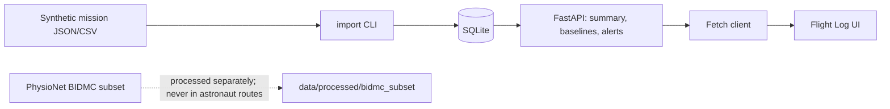

# AstroHealth — TorresTech

An educational prototype for monitoring the health indicators of a fictional astronaut mission, with individual reference comparisons and explainable experimental alerts.

## Resumen en español

AstroHealth es un prototipo educativo para el reto de NASA Space Apps Challenge 2026 "Create Health Monitoring Software for Astronauts on Space Missions". Muestra cinco indicadores (frecuencia cardíaca, SpO2, frecuencia respiratoria, sueño y ánimo) de astronautas **ficticios** durante una misión sintética de 30 días. El backend (FastAPI + SQLite) calcula una referencia individual experimental con los días 1–5 en reposo y genera alertas explicables con una única regla de demostración (`DEMO-HR-CHANGE`). La interfaz Flight Log (React) tiene cuatro vistas: Dashboard, Analytics, Alerts y Journal, y permite revisar la misión día a día. Los datos son sintéticos; los datos terrestres de PhysioNet BIDMC se procesan aparte y nunca se presentan como datos de astronautas. No es un sistema diagnóstico validado ni está afiliado a NASA ni avalado por ella. Guion de demo: [docs/demo_runbook.md](docs/demo_runbook.md).

## Challenge

NASA Space Apps Challenge 2026 — **"Create Health Monitoring Software for Astronauts on Space Missions"**: https://www.spaceappschallenge.org/2026/challenges/

## Problem

On long missions, astronauts are exposed to radiation, isolation and confinement, altered gravity and a closed environment, and they need to notice changes in their own health indicators without immediate help from Earth. That requires seeing each observation with its time, context and source, comparing it with the person's own reference, and knowing when there is not enough data to compare.

## Proposed solution and MVP features

Implemented in `main`:

- **Four views (Flight Log):** Dashboard, Analytics, Alerts and Journal.
- **Five indicators** with explicit units: heart rate (beats/min), SpO2 (%), respiratory rate (breaths/min) and resting context from readings; sleep (hours) and mood (score 1–5) from the daily journal.
- **Experimental individual baseline:** arithmetic mean of mission days 1–5, `rest` readings only for vitals, available from day 6 with at least 5 observations on 5 days. Mood is ordinal and never averaged. See [analysis.md](docs/architecture/analysis.md).
- **Experimental alert rule `DEMO-HR-CHANGE` (`fixture-1`):** resting heart rate at least baseline + 5 beats/min on two consecutive mission days after the reference window; resolved on the first later day below that threshold. It is a simulation assumption. See [alert_rules.md](docs/architecture/alert_rules.md).
- **Mission-day replay:** every view can be read at an observation cutoff (`as_of`); later data never leaks into an earlier day.
- **Visible provenance:** each value keeps its own timestamp, mission day, measurement context and source; missing values stay missing ("Not recorded"), never 0.

## Current capabilities

| Area | Available now | Remaining |
| --- | --- | --- |
| Dashboard | Five indicators with original timestamps/units/context/provenance; missing and earlier readings stay identifiable | Manual rendered check of the 30-day mission (#21) |
| Analytics | Vital and daily-journal charts, periods, individual reference, explicit gaps, accessible tables | Final cross-browser/accessibility review |
| Alerts | Read-only list/detail, status and explanation; backend rule `DEMO-HR-CHANGE` generates and resolves alerts | Manual rendered check of generated alerts (#21) |
| Journal | Mock workflow and real HTTP create/correct/retry; SQLite persistence across restart verified | Broader assistive/cross-browser review |
| API | SQLite, profiles/readings/journal/summary/alerts routes, JSON/CSV import, staged days, explicit CORS, Swagger, experimental baselines (#14) and alert engine (#15) | HTTP exposure of trends (needs a contract agreement) |
| Data | Contract seed; reproducible 30-day synthetic mission (DATA-04); processed PhysioNet BIDMC subset; indicator and source research | Scientific review of the experimental rule |

## Architecture and stack

| Layer | Stack |
| --- | --- |
| Frontend (Flight Log) | React, TypeScript, Vite, Tailwind CSS, Lucide React, Recharts; one `HealthDataSource` interface with a Fetch (API) or mock adapter |
| Backend | FastAPI, Pydantic, Uvicorn, Pandas, SQLite |



Physiological readings and the daily journal keep separate cadences. Cutoffs and timestamps are UTC. The backend owns baselines and alert rules; the mock adapter only illustrates the shared fixture cases. Terrestrial BIDMC records are normalized by their own pipeline and are never loaded into the astronaut routes.

## Quick start: 30-day demo (main path)

Prerequisites: Python 3.11 or newer (verified with 3.13.3); Node.js `^20.19.0 || >=22.12.0` and npm (from `frontend/package.json`). The integration smoke needs Node 22.13+.

Backend, from the repository root in PowerShell:

```powershell
py -3 -m venv .venv
.\.venv\Scripts\python.exe -m pip install -r backend\requirements-dev.txt
$env:ASTROHEALTH_CORS_ORIGINS = "http://localhost:5173,http://127.0.0.1:5173"
$env:ASTROHEALTH_DB_PATH = Join-Path $env:TEMP ("astrohealth-demo-" + [guid]::NewGuid().ToString("N") + ".db")
cd backend
..\.venv\Scripts\python.exe -m app.database import-json ..\docs\examples\mission_seed.json --until-day 7
..\.venv\Scripts\python.exe -m app.database import-json ..\data\synthetic\mission_ast101_ast102.json --until-day 30
..\.venv\Scripts\python.exe -m uvicorn app.main:app --port 8000
```

Health: http://127.0.0.1:8000/api/health · Swagger: http://127.0.0.1:8000/docs · OpenAPI: http://127.0.0.1:8000/openapi.json

Frontend, in another terminal:

```powershell
cd frontend
npm ci
```

Create `frontend/.env.local` (local only, not committed):

```dotenv
VITE_DATA_SOURCE=api
VITE_API_BASE_URL=http://localhost:8000
VITE_JOURNAL_SOURCE_ID=SYN-AH-MISSION-001
VITE_JOURNAL_TIME_UTC=08:00:00
```

Then run `npm run dev`, open http://127.0.0.1:5173/#/dashboard and choose **AST-101**. Use a new database path for each rehearsal; never reset a teammate's working database. Restart Vite after changing `.env.local`. A failed API never falls back to bundled fixtures.

`VITE_JOURNAL_SOURCE_ID` and `VITE_JOURNAL_TIME_UTC` enable new journal entries for the imported mission; they are public configuration, not credentials. Use `SYN-CORE-001` only with the contract seed mission.

The expected scenario (day 5 no reference, day 9 isolated spike without alert, days 12–14 missing values, day 19 warning, day 22 resolved, AST-102 insufficient data) is in [integration_smoke_test.md](docs/architecture/integration_smoke_test.md#expected-30-day-scenario) and the presentation script in the [demo runbook](docs/demo_runbook.md).

For staged replay, import the seed with `--until-day 3`, then `--until-day 5`, in a second terminal with the **same absolute `ASTROHEALTH_DB_PATH`**. Repeating an import creates no duplicates. Going backwards keeps stored later rows: use `post_import.cutoffs[astronaut_id]` as API `as_of`.

## Regenerate the data

Synthetic 30-day mission (no network; byte-identical for the same arguments), from the repository root:

```powershell
.\.venv\Scripts\python.exe data\scripts\generate_synthetic_mission.py --seed 2026 --start-date 2026-11-01
```

Terrestrial BIDMC subset (downloads three PhysioNet records and verifies checksums, then normalizes them):

```powershell
.\.venv\Scripts\python.exe data\scripts\acquire_bidmc.py
.\.venv\Scripts\python.exe data\scripts\normalize_bidmc.py
```

Details: [data/README.md](data/README.md) and [data/synthetic/README.md](data/synthetic/README.md).

## Mock demo (plan B) and checks

Mock demo, with no backend: in `frontend`, `npm ci` and `npm run dev` with no `.env.local` (or `VITE_DATA_SOURCE=mock`). The mission bar shows **Synthetic demo**. The mock uses the seven-day contract fixtures; its alert is an illustration and must not be presented as a backend-generated alert. Vite uses a strict port; if 5173 is taken, use `npm run dev -- --port 5175` and add that origin to `ASTROHEALTH_CORS_ORIGINS`.

| Check | Command (from) |
| --- | --- |
| Backend tests | `..\.venv\Scripts\python.exe -m pytest` and `..\.venv\Scripts\python.exe -m pip check` (backend) |
| Data tests | `.\.venv\Scripts\python.exe -m pytest data\tests -q` (root) |
| Mission rule validation | `.\.venv\Scripts\python.exe scripts\validate_mission_rules.py` (root) |
| Real HTTP integration smoke | `.\.venv\Scripts\python.exe scripts\check_local_integration.py` (root; add `--node <path>` if Node is not on PATH) |
| Frontend | `npm run check` and `npm run build` (frontend); `npm run check:health -- http://127.0.0.1:8000` probes a running API |
| CI | [GitHub Actions](docs/testing/ci.md): frontend checks/build; backend tests and the real integration smoke on Ubuntu and Windows |

The integration smoke uses its own temporary databases and loopback servers: it replays the seven-day seed (cutoffs, idempotence, CORS, eight frontend client checks, restart persistence), then imports the 30-day mission and checks baseline, generated alert, resolution, nulls and the frontend response guards. It does not test the browser. Backend tests report four strict xfails: two for the documented day-5/day-6 baseline difference and two fixtures of the earlier not-implemented stage. Latest recorded results: [integration21_results.md](docs/testing/integration21_results.md).

## Application loading and consistent views

The loading/recovery shell imports the application separately, so a rejected application chunk or connection configuration shows a reload action instead of an empty root. Route/render errors have the same recovery frame; unsaved Journal changes may be lost on reload. Raw configuration values and stack traces are not displayed. History, journal and alert requests share the displayed summary's observation cutoff; a later reading appears after **Refresh data** advances that summary. Missing pages, repeated offsets or changing pagination totals are errors rather than partial history shown as complete.

Evidence: [integration smoke procedure](docs/architecture/integration_smoke_test.md), [#21 results](docs/testing/integration21_results.md), [integration update](docs/testing/integration_update_20261115.md), [#13 recovery/cutoff update](docs/testing/frontend13_update.md) and the older [historical autonomous report](docs/autonomous_progress.md).

## Data, evidence and limitations

- [Data sources, evidence and citations](docs/data_sources.md) · [health indicators](docs/research/health_indicators.md) · [dataset candidates](docs/research/dataset_candidates.md) · [validation review](docs/research/validation_review.md)
- [Baseline analysis](docs/architecture/analysis.md) · [alert rules](docs/architecture/alert_rules.md) · [API/data contract v0.1.0](docs/api_contract.md) and its [shared examples](docs/examples/api_examples.json)
- [UX requirements](docs/ux_requirements.md) · [Flight Log rationale and captures](docs/design/redesign_rationale.md) · [frontend acceptance](docs/testing/frontend_acceptance.md) · [browser acceptance](docs/testing/browser13_acceptance.md) · [accessibility checklist](docs/testing/accessibility_review.md)

Statements:

- All astronaut profiles and the mission are **fictional and synthetic**.
- Terrestrial records (PhysioNet BIDMC PPG and Respiration Dataset v1.0.0, DOI 10.13026/C2208R, ODC-By v1.0) are identified separately with their citation and are never relabeled as astronaut data.
- Baselines and the alert rule are **experimental**. This is not a validated diagnostic system and makes no clinical claims.
- This project is not affiliated with or endorsed by NASA.

Known limitations:

- The alert explanation reads "Fixture days 18-19 …" for the synthetic mission, because the text must match the contract fixture (low severity; mission wording needs a future contract change).
- The baseline is available from mission day 6; the contract fixture shows it at the end of day 5.
- The JavaScript bundle exceeds Vite's advisory 500 kB threshold; the warning is visible, not suppressed.
- The rendered 30-day checks, actual 200% zoom and keyboard checks are still "Pending manual run" in [integration21_results.md](docs/testing/integration21_results.md).
- Trends and descriptive statistics are calculated internally but have no HTTP fields yet.

## Team and ownership

| Person | Area |
| --- | --- |
| Jorge — [@Almejandro04](https://github.com/Almejandro04) | Frontend (Flight Log) and team lead |
| Jhonatan — [@TheJhonatan144](https://github.com/TheJhonatan144) | Backend: API, storage, ingestion, analysis, alerts |
| Ismael — [@BrandonFreire](https://github.com/BrandonFreire) | Data and research |

Delivered work and next tasks: [docs/team_handoff.md](docs/team_handoff.md).

## Team workflow

Use a separate checkout and personal task branch from current `main`. Commit reviewable changes, fetch again before integration, preserve teammates' concurrent commits and resolve conflicts explicitly; integrate only verified changes. The owner permits direct merges/pushes by collaborators with write access; PRs remain optional. Do not force-push shared branches. Data changes belong to their owners; preserve the approved contract or coordinate a documented change first.

## License

[Apache License 2.0](LICENSE).

## AI tools disclosure

The team used AI assistants: Claude Code (Anthropic) to implement code and documentation, and OpenAI Codex to review and audit changes. Every change was reviewed by the team. Scientific sources are cited with their access date and were checked against the original publications and official repositories; see the [NASA Space Apps citation section](docs/data_sources.md#nasa-space-apps-citation).
