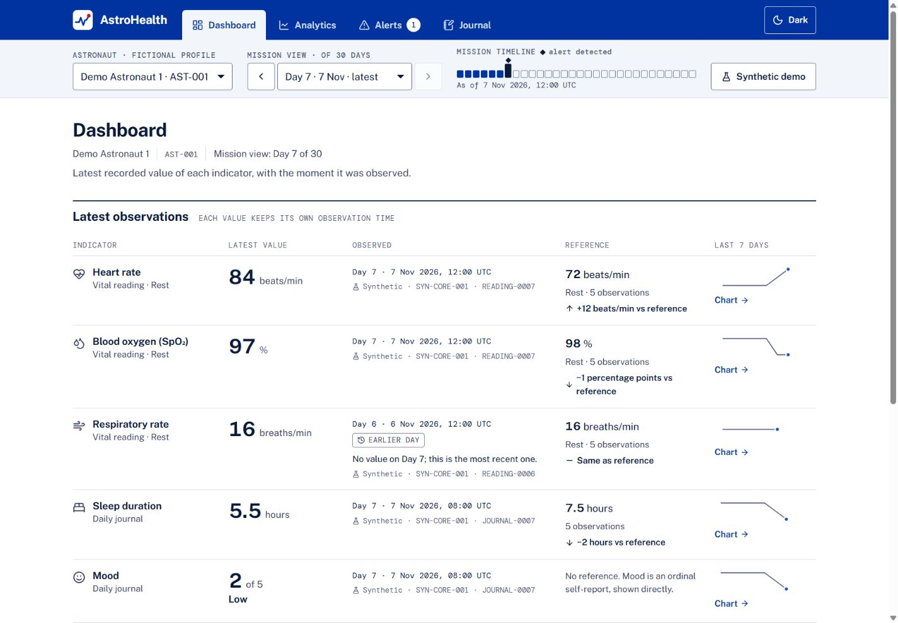
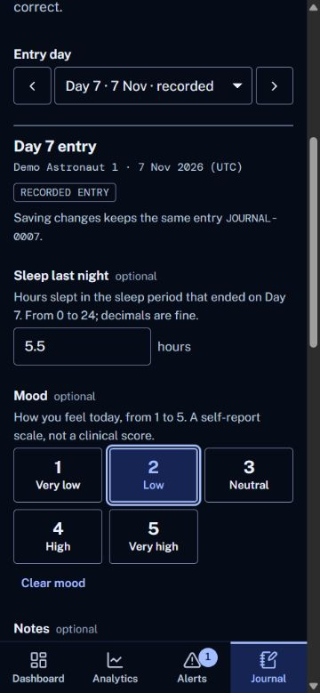

# Flight Log — design rationale and verification

## Continuation of the existing design

Claude implemented Flight Log in feature/frontend-01-setup. This continuation preserves the NASA Blue masthead, tabs, mission context, ruled readout/table composition, typography, themes and all four views. It does not replace that design with a new mockup.

Identity uses NASA Blue #0032A0 and NASA Red #E4002B; semantic action, critical, warning, success, information and unknown tokens have independent roles. Success describes an action confirmation, never a health conclusion. Dark-mode controls use a lighter action tint because brand blue has insufficient contrast on the dark page.

Typography is self-hosted Public Sans for interface text and DM Mono for values, dates and technical labels. Major targets use a 44px token. Dense timeline pointer shortcuts have an equivalent labeled select for keyboard use. Charts supplement color with points, labels and data tables; categorical colors alone do not prove accessibility for every color-vision deficiency.

## HCI decisions and observable checks

| Principle | Decision | Verification |
| --- | --- | --- |
| Visibility of status | Separate loading, read failure, empty history, insufficient analysis and saved/uncertain writes | Failed-read and unavailable-analysis scenarios; Day 3 replay; journal rejected/unconfirmed writes |
| Match to users' concepts | Mission day, familiar section names, unit and original observation time | Dashboard and chart/table inspection |
| User control | Cancel restores values; leaving a dirty journal asks; replay can return to latest | Cancel, Keep editing, browser history and return-to-latest checks |
| Consistency and recognition | Same four destinations, mission context and theme control | Route navigation at desktop and mobile widths |
| Error prevention/recovery | Validate sleep; retain drafts on rejection; safe daily-entry retry | Invalid sleep focuses its field; rejected and uncertain save retain text and ID |
| Minimal presentation | Ruled groups and aligned values replace decorative cards | Desktop review |
| Fitts / Hick | Large major controls, four primary destinations, demo settings in a separate dialog | Mobile navigation and native controls |
| Jakob / proximity | Standard links/forms, adjacent labels/help, grouped evidence and context | Native radio/select behavior, data-table disclosure and alert detail |
| Differentiation | Attention icons/text and historical-view banner supplement hue | Alert details and historical Day 3 |

These are design decisions and focused checks, not a formal usability study or complete WCAG certification.

## Corrections made during continuation

1. At 375px, Journal initially had about 464px of scrollable width: the browser's anonymous fieldset layout kept the mood choices at their intrinsic width. Block flow for the semantic mood fieldset lets its existing responsive grid wrap. The corrected journal and Analytics/Alerts had no document-level horizontal overflow; wide data tables keep their own local scroll area.
2. Save feedback previously received focus before its DOM content was rendered. A save-state effect now focuses the rendered confirmation/error region. A successful correction was observed with focus on journal-form__feedback.

## Executed verification

- Clean npm ci from the committed dependency lockfile.
- TypeScript, all 94 contrast pairs (both themes), mock response/write/error/replay checks and final Vite production build passed.
- Desktop 1440px light Dashboard inspected. Mobile 375px dark Dashboard, Analytics, Alerts and Journal inspected, including a chart and its data table.
- Invalid sleep input showed guidance and focused the invalid field; cancellation restored the recorded entry.
- Dirty Journal navigation offered Keep editing / Discard changes; Keep editing preserved the draft.
- A simulated 422 retained notes. A normal correction saved under JOURNAL-0007. An unconfirmed save retained the draft and retry confirmed the same daily ID.
- Alert detail evidence and browser Back/Forward worked.
- Analytics 3-day selection updated the URL and period to Days 5–7.
- Historical Day 3 showed insufficient analysis and excluded later alerts; Return to latest restored Day 7.
- Failed profile reads produced an error rather than a healthy/empty result; switching back to normal recovered reads.

The 94-pair script verifies its enumerated token pairs, not every possible rendered overlay. Claude reported color-vision palette checks; no independent simulation/certification is claimed in this continuation.

## Remaining checks and integration decisions

- Actual browser zoom at 200% remains a manual check: the in-app browser shortcut did not change the observed viewport/pixel ratio. Narrow-layout checks do not substitute for a real zoom result.
- Complete assistive-technology and cross-browser evaluation remains pending.
- Live journal effective timestamp/source selection must be agreed before #13 writes to FastAPI; current 08:00 UTC / SYN-CORE-001 convention is mock-only.
- Journal storage remains page-session memory; samples are presentation fixtures, not newly validated biomedical rules.
- The approximately 779 kB JavaScript bundle triggers Vite's 500 kB warning. It builds successfully; route/chart splitting is a possible performance follow-up.
- Review disposition: PR #24 was subsequently merged and #2 closed with user authorization. Later functional acceptance and remaining integration work are tracked in docs/testing/frontend_acceptance.md.

## Manual smoke sequence

Run npm ci, npm run check and npm run build. Start Vite or preview, then visit all four views; refresh a detail route; test Back/Forward and the unknown-route recovery. At 375px in both themes and at actual 200% browser zoom, inspect controls, charts, scrollable tables and dialogs. Use Tab/Shift+Tab, Enter, Escape and radio arrow keys; verify visible focus and skip link. Exercise valid/invalid Journal, Cancel, dirty navigation, rejected/network/unconfirmed saves, retry, empty profile and failed reads. Recheck only affected paths after fixes.

## References

- [Nielsen's usability heuristics](https://www.nngroup.com/articles/ten-usability-heuristics/)
- [Laws of UX](https://lawsofux.com/)
- [WCAG contrast minimum](https://www.w3.org/WAI/WCAG22/Understanding/contrast-minimum.html)
- [NASA brand guidelines](https://www.nasa.gov/nasa-brand-center/brand-guidelines/)
- [Approved API contract](../api_contract.md) and [UX requirements](../ux_requirements.md)

## Review captures

The final checkout also passed unknown-route recovery, refresh, the skip link, explicit dirty-form discard and a light-theme mobile Journal check. No browser-console errors were captured during the review.
