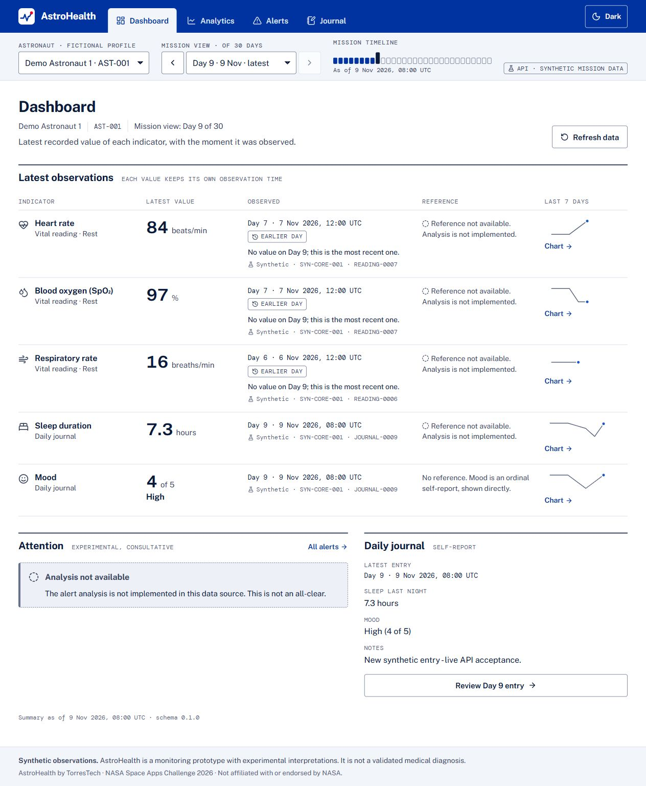
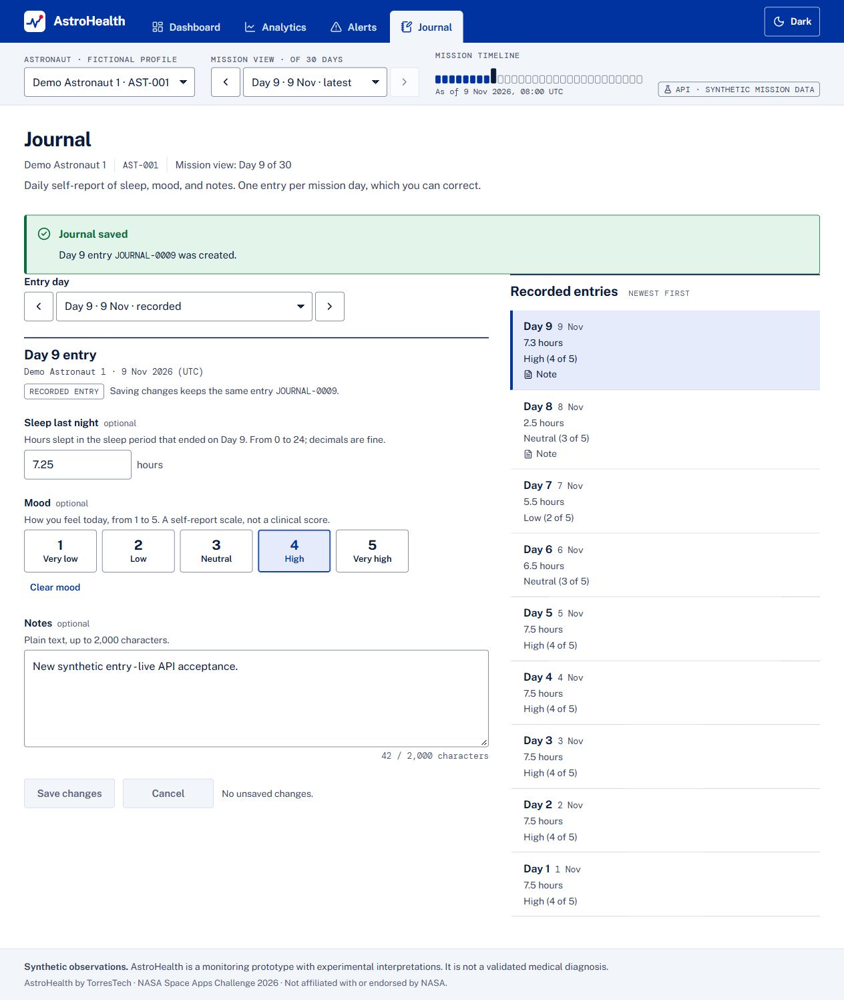
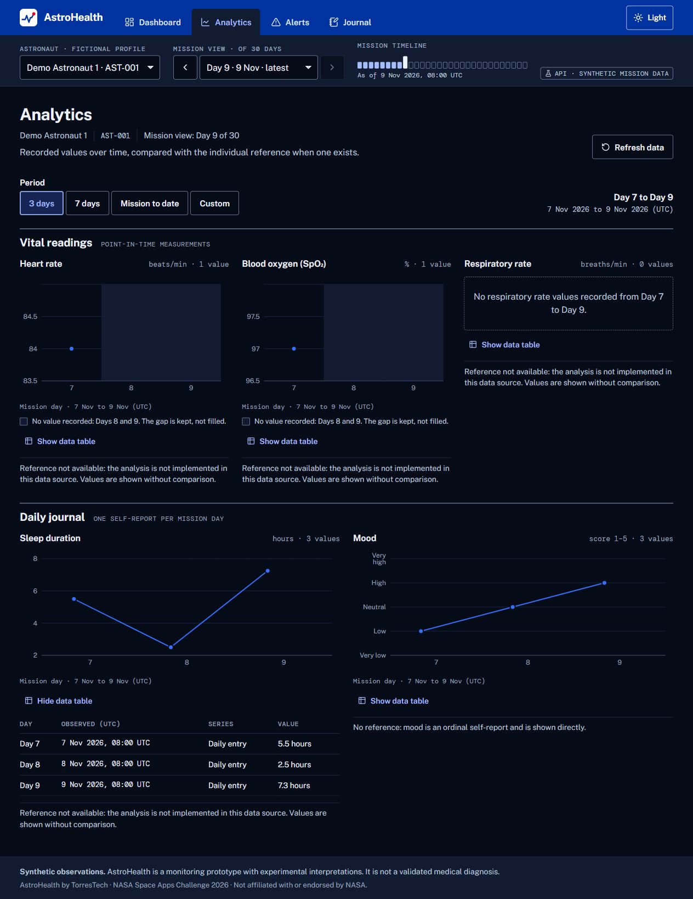
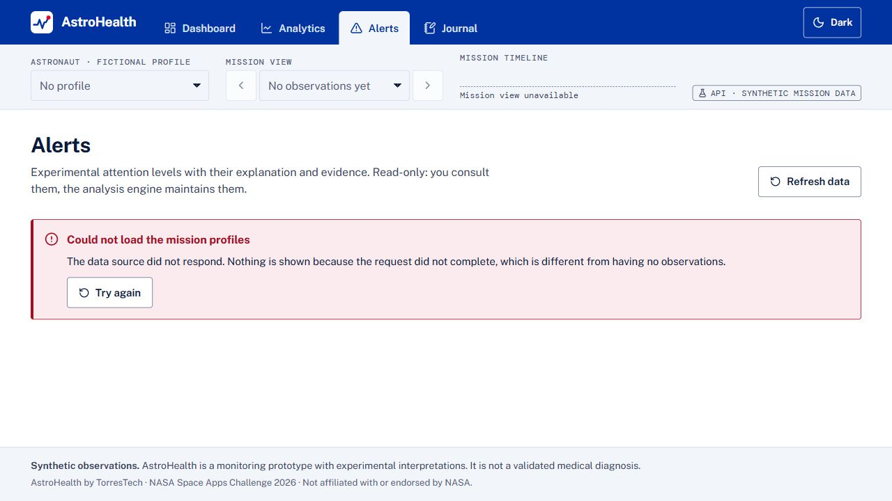
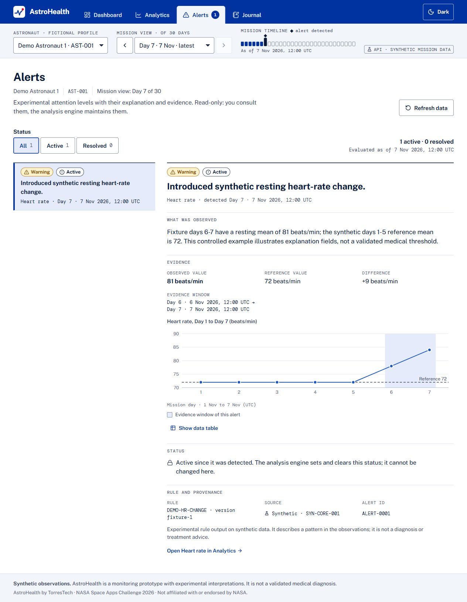

# Browser acceptance — FRONTEND-06 (#13) and Journal (#17)

## Scope

Verified in the visible ChatGPT in-app browser on 2026-11-15, using an isolated checkout based on main 655f5b00e3c9053e31c38dd6a832c30190f5f998 plus the Journal feedback fix below. The real review used Vite on loopback port 5177, explicit API mode, exact CORS, a new temporary SQLite database and the actual FastAPI service. No teammate database or worktree was reset.

The starting input was the seven-day CORE-01 seed, imported incrementally through days 3, 5 and 7. Browser-created journal entries then advanced the latest view to days 8 and 9. This does not constitute delivery of Ismael's 30-day DATA-04 dataset.

## Real FastAPI/SQLite browser checks

| Check | Observed result |
| --- | --- |
| Dashboard identity/data | AST-001/day 3 showed persisted HR 72, SpO2 98, respiration 16, sleep 7.5 and mood 4, with original timestamps/units/source/record IDs and API synthetic badge |
| Staged import + Refresh | Import day 5 then day 7, Refresh in Analytics: latest day and point counts advanced without changing the route/profile or selected 3-day range |
| Range/table values | Three-day selection changed days 3–5 to days 5–7; heart-rate table showed 72, 78, 84. Day-7 respiratory null stayed an explicit gap |
| Historical view | Selecting day 3 while day 7 was stored limited charts to days 1–3 and displayed the historical banner; Return to latest restored the latest view |
| Empty profile | AST-002 showed no observations/charts, not zero-valued normal health; switching back retained the chosen range |
| Alerts before #15 | Real API displayed Analysis not available and explained that the empty unevaluated list is not an all-clear |
| API stop/retry | Stopped only the owned FastAPI process, refreshed, then navigated Dashboard/Analytics/Alerts/Journal: each showed the mission-profile read failure. Restart + Try again recovered the real source while preserving AST-001/range=3d |
| Journal validation | Sleep 25 was rejected with field guidance and focus on the sleep input; note/mood draft remained intact. Sleep 0 was accepted |
| Journal create | Created day 8 as JOURNAL-0008 and day 9 as JOURNAL-0009 using explicit SYN-CORE-001 / 08:00 UTC metadata |
| Dirty navigation/cancel | Keep editing retained an edited day-8 draft; Cancel on a disposable new draft restored its empty saved state |
| Failed write/retry | Stopped API with an edited day-8 draft, submitted with Enter: unconfirmed-save message retained sleep 2.5 and notes. Restart + Try again updated JOURNAL-0008 without duplication |
| New-entry feedback | After the fix, day-9 creation retained Journal saved / JOURNAL-0009 after summary/history advanced to day 9, with focus on the confirmation container |
| Persistence and dependent views | Backend restart + browser reload retained days 8/9 and their IDs. Dashboard showed day-9 sleep/mood/notes; Analytics sleep table showed 5.5, 2.5, 7.3 for days 7/8/9 (API retains 7.25; UI rounds to one decimal) |
| Themes | Actual API views were inspected in light and dark; the final user-facing tab was restored to light |

## Alert contract readiness — separate test HTTP fixture

A separate Vite/API-mode tab on loopback port 5176 consumed the explicitly test-only HTTP fixture server, not FastAPI. It displayed the contract warning through the same Fetch adapter: Active/Warning, indicator and detection date, observed 81 vs reference 72, +9 difference, evidence window, rule DEMO-HR-CHANGE version fixture-1, source SYN-CORE-001 and read-only status.

This verifies frontend rendering when an HTTP response supplies the agreed alert shape. It is not proof that #15 generates or persists that alert. The full actual-engine scenario remains #15/#21. The fixture tab and its servers were closed after the check; the user-facing tab remains connected to real FastAPI.

## R1 recheck and discovered fix

R1's earlier blank API tab was rechecked with simultaneous mock/API dev modes. Without journal metadata, a new day-10 entry displayed New-entry setup pending and disabled save. Adding the explicit source/time, restarting API-mode Vite while the mock server remained running, and reloading displayed the form correctly. No blank tab recurred in this supported sequence. The original cause is not asserted.

An intentionally invalid API URL produced the independent Flight Log could not start recovery frame, with heading focus and Reload Flight Log action. Restoring the valid configuration/restarting Vite recovered Journal automatically. Expected generic startup-failure console messages were captured during this deliberate failure; no zero-console-error claim is made.

A real defect was found during creation: the summary cutoff changed, causing the journal-history subtree to remount and lose the just-rendered save confirmation/focus. Confirmation now belongs to JournalPage outside that loading subtree. Both a correction and a new-entry creation were rechecked: the confirmation remains, preserves the daily ID, and receives focus. The entry form still owns validation/failed-write feedback and draft protection.

## Automated checks and disposition

After the fix: npm run check passes (94 contrast pairs, shared mocks, 9 series/default checks, 15 HTTP-fixture client checks, 8 startup/view/history checks); npm run build, TypeScript and API-mode production build pass. The known approximately 791 kB combined JS output and 563 kB App-chunk advisory remain.

#13's supported frontend/API integration acceptance and #17's Journal acceptance are complete with this evidence. Actual generated-engine alerts, DATA-04, measured 200% zoom and broader assistive/cross-browser testing remain in #6/#14/#15/#21/#22, not claimed by this review. No new responsive viewport or actual 200% zoom measurement was performed.

## Captures

### Real API Dashboard

### Real API Journal confirmation

### Real API sleep-history table, dark theme

### Real API unavailable state

### Contract HTTP fixture only

